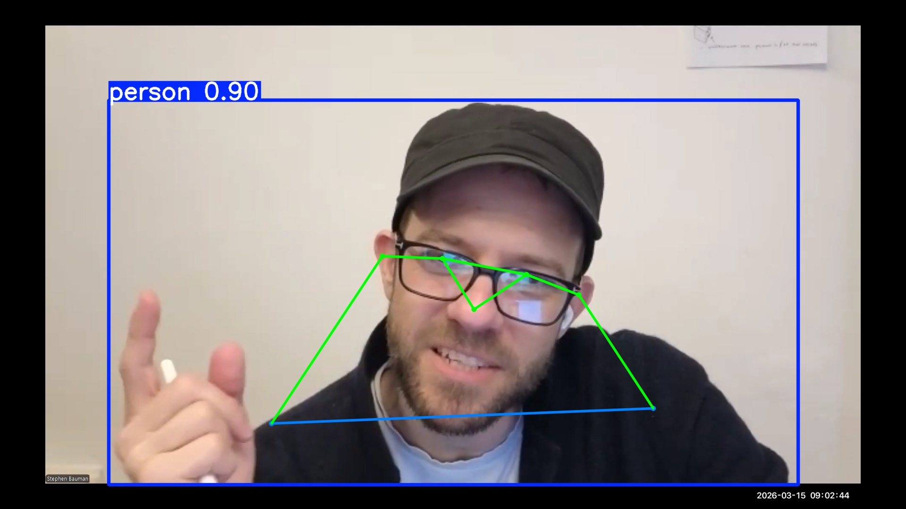

# Barbell Speed Estimator

Estimates barbell velocity from workout videos using YOLOv8 pose detection. Tracks wrist positions as a proxy for bar position, smooths the signal, and outputs position and velocity plots.

## How it works

1. Extracts frames from a video using ffmpeg
2. Runs YOLOv8n-pose on each frame to detect wrist keypoints
3. Averages left/right wrist positions to estimate bar position per frame
4. Applies outlier removal and Savitzky–Golay smoothing
5. Computes and plots bar velocity over time

## Requirements

```
pip install -r requirements.txt
```

ffmpeg must also be installed on your system and available on PATH.

## Usage

```bash
# Run pipeline (reconstructs annotated video, keeps all output)
python video_pose_infer.py videos/deadlift.mov

# Delete rendered images after reconstruction to save disk space
python video_pose_infer.py videos/deadlift.mov --clean

# Generate position/velocity plots from a saved track
python analysis.py
```

Output is saved to `pose_results/`:
- `barbell_track.json` — bar position per frame
- `analysis/bar_speed.png` — position and velocity plots

## Example output


