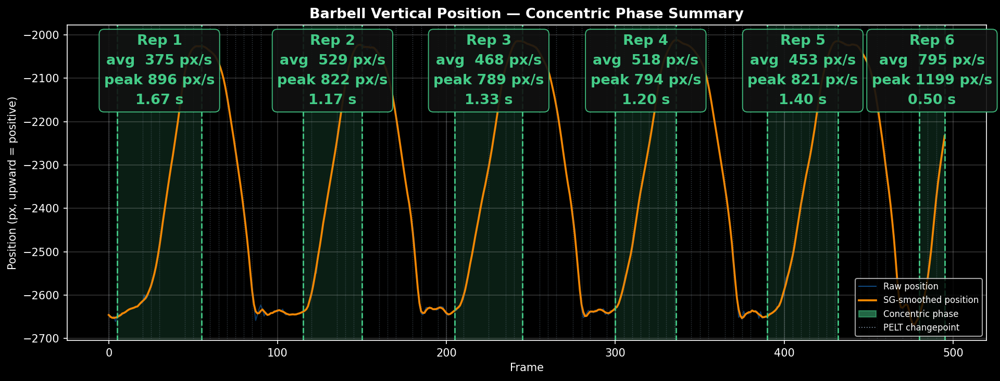
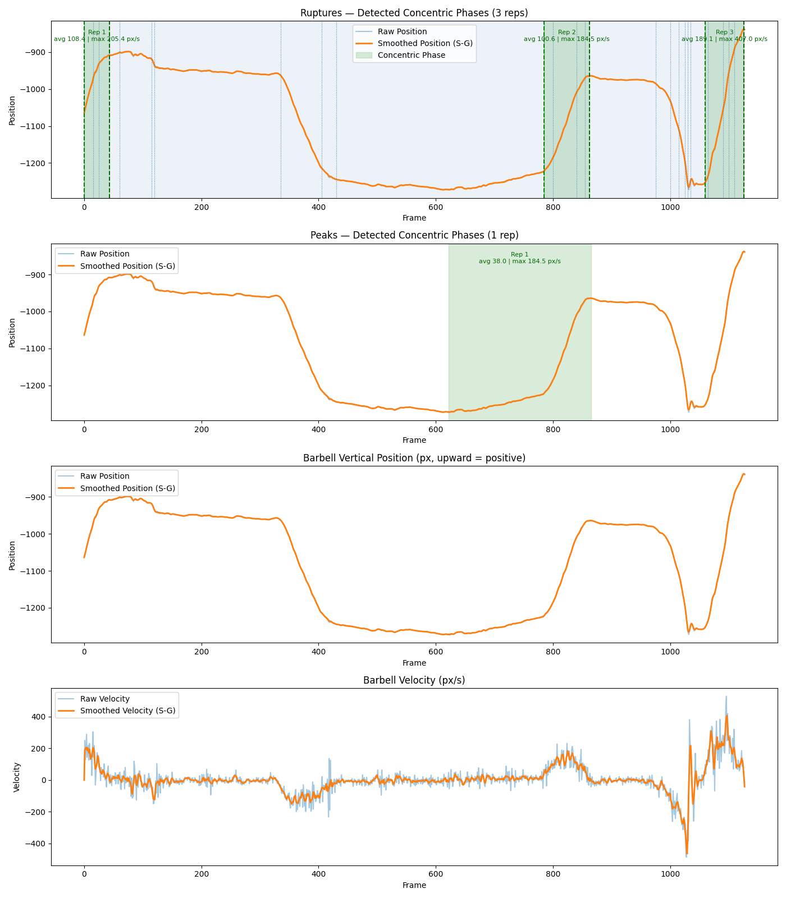
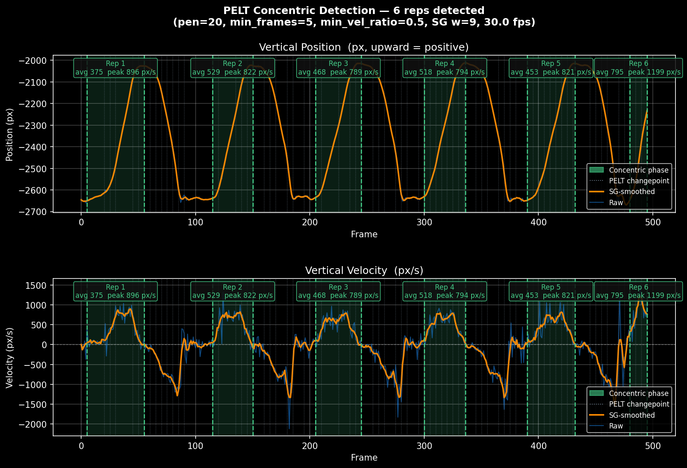

# Barbell Speed Estimator

Estimates barbell velocity from workout videos using computer vision. Three pipelines are available — the YOLO Pose pipeline is the recommended starting point and requires no GPU.



---

## Pipelines at a glance

| Pipeline | Tracks | Output | GPU required? |
|---|---|---|---|
| **YOLO Pose** (recommended) | Wrist keypoints as barbell proxy | px/s | No |
| **YOLO-seg** | Barbell plate (instance segmentation) | m/s | No (faster with GPU) |
| **SAM2** (experimental) | Barbell plate (video segmentation) | m/s | Recommended — see note |

---

## Installation

### Python dependencies

```bash
pip install -r requirements.txt
```

> **PyTorch note:** The above installs a CPU-only build of PyTorch by default. For GPU acceleration, install the right wheel for your system first by following the instructions at [pytorch.org/get-started/locally](https://pytorch.org/get-started/locally/), then run `pip install -r requirements.txt`.

### ffmpeg

ffmpeg must be installed separately and available on your `PATH`.

- **Windows:** `winget install ffmpeg` or download from [ffmpeg.org](https://ffmpeg.org/download.html)
- **macOS:** `brew install ffmpeg`
- **Linux:** `sudo apt install ffmpeg`

### SAM2 — CUDA compatibility note

SAM2 has known build conflicts with certain CUDA/driver combinations, particularly on Windows. If you only want to use the YOLO Pose or YOLO-seg pipelines you can skip SAM2 entirely. If you do want to run the SAM2 pipeline:

- **CPU fallback:** Pass `--offload-to-cpu` to run on CPU. This works but is slow.
- **Full GPU support:** Requires building SAM2 from source with a matching CUDA toolkit and MSVC toolchain. See the [SAM2 installation docs](https://github.com/facebookresearch/segment-anything-2) for details.

---

## Primary Pipeline — YOLO Pose

Uses YOLOv8-pose wrist keypoints as a proxy for the barbell. Reliable across deadlifts and squats; does not require plate visibility or calibration. Outputs velocity in px/s.

```bash
# Run the pipeline (default model: small)
python yolo_pose/pose_velocity.py --video videos/deadlift.mov

# Choose model size: nano | small | medium | large (positional argument)
python yolo_pose/pose_velocity.py large --video videos/deadlift.mov

# Delete intermediate frames and keypoint JSONs after reconstruction
python yolo_pose/pose_velocity.py --video videos/deadlift.mov --clean

# Run analysis and plot velocity (after pose_velocity.py)
python yolo_pose/analysis.py
python yolo_pose/analysis.py --track pose_results/deadlift/small/barbell_track.json
```

**Output** (written to `yolo_pose/pose_results/<video>/<model>/`):
- `barbell_track.json` — bar centroid per frame
- `meta.json` — FPS and video metadata
- `bar_speed.png` — position and velocity plots
- `<video>_output.mp4` — annotated video with wrist overlay



### Concentric phase detection

`analysis.py` can automatically detect concentric phases (the lifting portion of each rep) using PELT changepoint detection via the `ruptures` package. Detected phases are highlighted on the velocity plot.



Configure at the top of `yolo_pose/analysis.py`:

| Variable | Default | Description |
|---|---|---|
| `CONCENTRIC_METHOD` | `"both"` | `None` \| `"ruptures"` \| `"peaks"` \| `"both"` |
| `MIN_FRAMES` | `5` | Minimum segment length (frames) to be a candidate |
| `MERGE_MIN_VEL` | `50.0` | px/s — segments below this excluded from merge runs |
| `EXTENSION_LOOKAHEAD` | `30` | Max boundary extension per side (frames) |
| `MIN_VEL_RATIO` | `0.50` | Reject candidates below this fraction of median candidate velocity |

---

## YOLO-seg Pipeline

Uses YOLOv8 instance segmentation and BotSORT tracking to follow the barbell plate directly. No manual prompt needed — the script auto-selects the largest detected mask on the first frame, or opens an interactive picker. Calibrates scale from the known plate diameter and outputs velocity in m/s.

```bash
python yolo_seg/yolo_velocity.py --video videos/deadlift.mov

# Skip interactive selection, auto-pick the largest mask
python yolo_seg/yolo_velocity.py --video videos/deadlift.mov --no-preview

# Specify model size (nano | small | medium)
python yolo_seg/yolo_velocity.py --video videos/deadlift.mov --model small
```

**Key arguments:**

| Argument | Default | Description |
|---|---|---|
| `--plate-mm` | `450` | Known plate diameter in mm (for scale calibration) |
| `--model` | `nano` | YOLOv8-seg variant: `nano` \| `small` \| `medium` |
| `--frame-step` | `1` | Process every Nth frame |
| `--max-seconds` | (none) | Only process first N seconds |
| `--conf` | `0.25` | Detection confidence threshold |

**Output** (written to `yolo_results/<video>/`):
- `velocities.csv` — columns: `frame, timestamp_s, cx_px, cy_px, velocity_ms, smoothed_velocity_ms`

---

## SAM2 Pipeline (Experimental)

Uses SAM2 video segmentation to track the barbell plate through the video. Provides real-scale velocity in m/s, but is unreliable on real gym footage — tracking can drift, lose the object, or latch onto the wrong region mid-lift. Prefer the YOLO-seg pipeline for plate tracking.

> See the [CUDA compatibility note](#sam2--cuda-compatibility-note) above before running this pipeline.

```bash
# Interactive: opens frame 0 to draw a box or click the plate
python sam2/barbell_velocity.py --video videos/deadlift.mov

# Non-interactive: provide a bounding box
python sam2/barbell_velocity.py --video videos/deadlift.mov --box "100,200,400,500"

# CPU-only fallback (slow but works without a compatible CUDA build)
python sam2/barbell_velocity.py --video videos/deadlift.mov --offload-to-cpu
```

**Key arguments:**

| Argument | Default | Description |
|---|---|---|
| `--plate-mm` | `450` | Known plate diameter in mm |
| `--model` | `small` | SAM2 variant: `tiny` \| `small` \| `large` |
| `--box` | (interactive) | `"x_min,y_min,x_max,y_max"` for frame 0 |
| `--point` | (interactive) | `"x,y"` single foreground point for frame 0 |
| `--offload-to-cpu` | off | Keep frame features in CPU RAM (reduces VRAM use) |
| `--no-recovery` | off | Disable interactive recovery on tracking loss |
| `--max-seconds` | (none) | Only process first N seconds |
| `--frame-step` | `1` | Process every Nth frame |

**Output** (written to `sam2_results/<video>/`):
- `velocities.csv` — columns: `frame, timestamp_s, cx_px, cy_px, velocity_ms, smoothed_velocity_ms`

---

## Post-processing Tools

### Overlay annotated video

Draws a centroid crosshair and velocity label on each frame and writes an annotated video. Works with the CSV output from any pipeline.

```bash
python tools/overlay.py --video videos/deadlift.mov --csv sam2_results/deadlift/velocities.csv
```

### Plot velocity

Plots position and velocity from a CSV. Auto-discovers the newest CSV under `sam2_results/` or `yolo_results/` if no `--input` is given.

```bash
python tools/plot_velocity.py
python tools/plot_velocity.py --input sam2_results/deadlift/velocities.csv --show
```

---

## Output directories

All output directories are created automatically by the scripts when they first run. They are excluded from version control:

| Directory | Created by | Contents |
|---|---|---|
| `yolo_pose/pose_results/` | `yolo_pose/pose_velocity.py` | Barbell track JSON, annotated video, velocity plots |
| `yolo_results/` | `yolo_seg/yolo_velocity.py` | `velocities.csv` |
| `sam2_results/` | `sam2/barbell_velocity.py` | `velocities.csv` |

The `videos/` directory is also excluded — bring your own footage. Suggested structure: `videos/Deadlift/`, `videos/Squat/`, `videos/Bench/`.

---

## Intended use case

The natural product form for this pipeline is a web platform where users upload pre-recorded videos of their sets. The existing pipeline runs entirely unchanged in that context — no modifications are needed to support video uploads versus local files. Users record on their phone, upload the video, and receive a velocity plot and per-rep averages in return.

---

## Real-time detection

If live video were required — streaming from a phone during a set and outputting rep velocity as each rep completes — the current pipeline would need two changes:

- **Savitzky-Golay smoothing** requires future frames and cannot run in real-time. It would need to be replaced with a causal filter (e.g. exponential moving average).
- **PELT changepoint detection** is an offline algorithm that operates on the full signal. It would need to be replaced with an online method.

A **Hidden Markov Model (HMM)** is a natural fit for the online case. The lift has three well-defined states with known velocity characteristics — rest (~0), concentric (positive), and eccentric (negative) — which map directly onto HMM states. The HMM forward algorithm updates the state probability distribution one frame at a time, making it suitable for real-time use. Average concentric velocity could be output as soon as the model detects a transition from concentric back to rest.

---

## Notes

- **Y-axis convention:** Upward movement is positive velocity throughout all pipelines. The raw `cy_px` centroid is negated before velocity is computed so that a rising bar reads as a positive value.
- **Units:** YOLO Pose outputs px/s. The segmentation pipelines (YOLO-seg and SAM2) calibrate scale from the plate diameter and output m/s.
- **Bench press:** YOLO Pose struggles with bench press — wrists are often occluded or the athlete is lying down, making person detection unreliable. The YOLO-seg pipeline is a better fit for bench.
- **SAM2 tracking reliability:** SAM2 can drift, lose the plate, or latch onto a nearby object (e.g. another plate, the sleeve) mid-lift. Results should be inspected visually.
